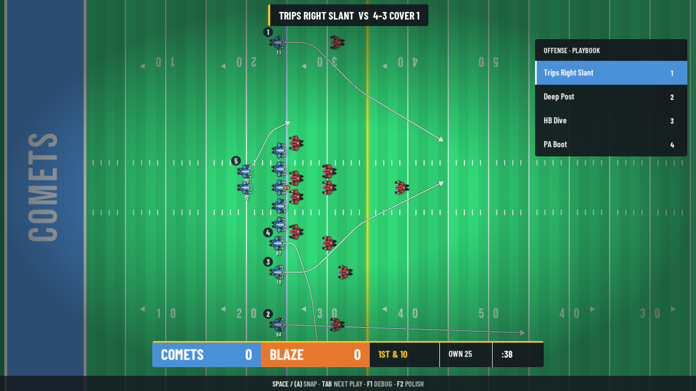
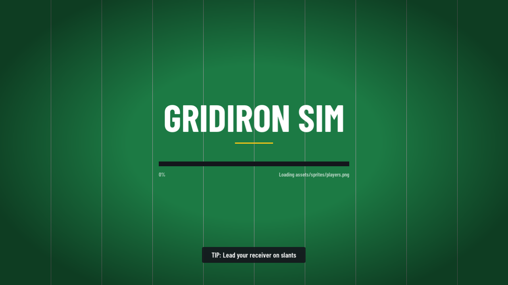
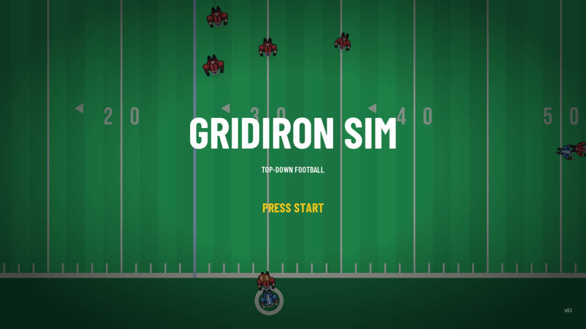
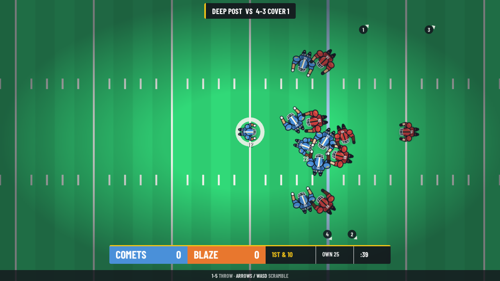
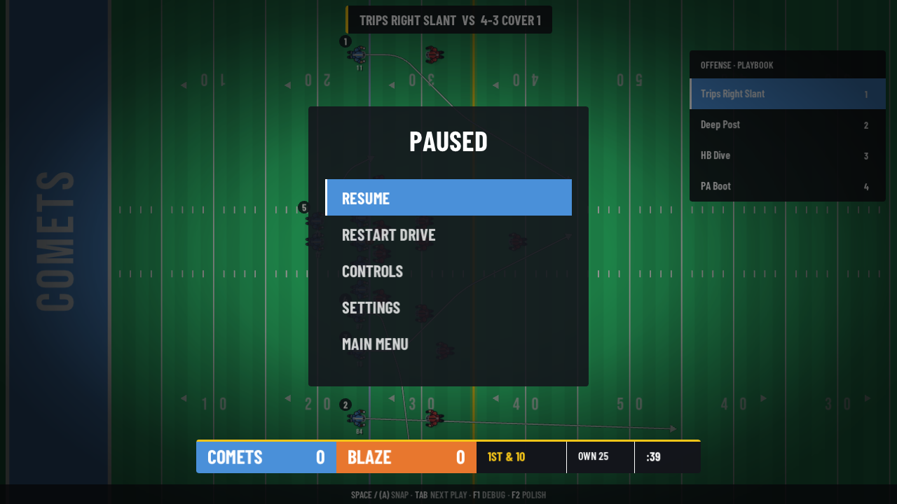
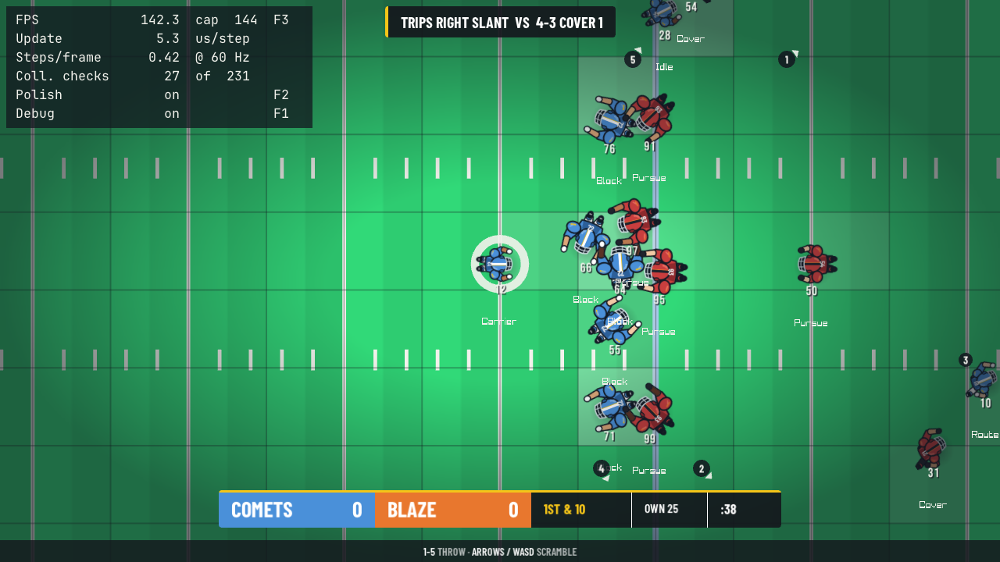

# Gridiron Sim

[](../../actions/workflows/ci.yml)

A top-down 2D American football play simulator written in modern C++17. Plays are loaded from
JSON files, 22 players run a per-player state machine with steering-based AI, collisions go
through a uniform-grid spatial hash, and the whole simulation runs on a deterministic 60 Hz
fixed timestep, separate from rendering. The game logic is a standalone library with no
rendering dependency, so it builds and is unit-tested headless. raylib is used only in a thin
platform layer for the window, input and drawing.



## Screenshots

| | |
|---|---|
|  |  |
| **Loading**: manifest-driven progress, decoded on a worker thread | **Title**: a real simulated play runs behind the menu |
|  |  |
| **Live play**: block, pursue and run poses from the simulation state | **Pause**: the simulation freezes behind the menu |
|  | |
| **Debug overlay (F1)**: frame timing, collision checks vs. brute force, the spatial-hash grid and each player's AI state | |

## Building

Requirements: CMake 3.25+, a C++17 compiler (MSVC 2022, GCC 11+ or Clang 14+), and Git.
raylib, nlohmann/json and Catch2 are downloaded automatically by CMake (FetchContent). Nothing
needs to be installed by hand.

### Windows (PowerShell, Visual Studio 2022 or Build Tools 2022)

```powershell
cmake -S . -B build -G "Visual Studio 17 2022"
cmake --build build --config Release --parallel
ctest --test-dir build -C Release --output-on-failure
.\build\bin\Release\gridiron.exe
```

The first configure downloads the dependencies and takes about a minute.

### Linux

```bash
sudo apt-get install -y libx11-dev libxrandr-dev libxinerama-dev libxcursor-dev libxi-dev libgl1-mesa-dev
cmake -S . -B build -DCMAKE_BUILD_TYPE=Release
cmake --build build --parallel
ctest --test-dir build --output-on-failure
./build/bin/gridiron
```

### Build options

| Option | Default | Purpose |
|---|---|---|
| `GRIDIRON_BUILD_GAME` | `ON` | Build the raylib executable. `OFF` builds only the core library and tests. |
| `GRIDIRON_BUILD_TESTS` | `ON` | Build the Catch2 tests. |
| `GRIDIRON_WARNINGS_AS_ERRORS` | `OFF` | `/WX` / `-Werror` (CI turns this on). |

## Controls

| Action | Keyboard | Gamepad (Xbox layout) |
|---|---|---|
| Snap the ball | Space | A |
| Select play 1–4 (pre-snap) | 1 – 4 | X, Y, B, RB |
| Next play (pre-snap) | Tab | D-pad right |
| Throw to receiver 1–5 | 1 – 5 | X, Y, B, RB, LB |
| Move the ball carrier | Arrow keys / WASD | Left stick |
| Skip the result screen | Space | A |
| Debug view (off by default): stats, grid, player states | F1 | Back / View |
| Visual polish on/off (before/after comparison) | F2 | – |
| Cycle the render FPS cap (144 / 60 / 30 / 240 / uncapped) | F3 | – |
| Camera zoom in / out (0.5x–3x) | Mouse wheel | – |
| Back to the automatic camera | Middle mouse button | – |

Receivers show their throw button in a gold badge. Before the snap every route is drawn on the
field, and the overlay fades out after the snap.

## Presentation

All visual polish lives in `src/platform`. F2 turns it off to show the plain Milestone 1 look:

- One 7-color palette (`Theme.h`). Every color on screen is one of those 7 or a faded or
  brightened variant.
- Mowing stripes, team-colored end zones with team names, painted yard numbers with direction
  arrows, hash marks, and a vignette.
- Players with drop shadows, white outlines, facing indicators, and a pulsing ring on the ball
  carrier.
- A playbook overlay: routes drawn with rounded cuts and arrowheads.
- Camera zoom-out on deep passes, screen shake and grass particles on tackles (from a fixed
  256-particle pool, no per-frame allocations), a ball arc with a ground shadow that shrinks as
  the ball rises, and an eased "+N YDS" popup.
- A broadcast HUD rebuilt from a Figma design (frame "Football Broadcast HUD / 1280x720"):
  play-call banner, pre-snap playbook panel, scorebug (score, down & distance, field position,
  play clock), yards-gained popup with a FIRST DOWN tag, and a controls bar. Every color, size,
  padding and position is a named constant in `Theme.h` (`theme::hud`), named after its Figma
  layer, and every value shown comes from the game state in `src/core`.
- Camera: frames the whole formation before the snap (sprites never drawn below 26 px), then
  follows the action at a close zoom; receivers off screen get edge arrows with their throw
  number. While a pass is in the air, its landing spot and the intended receiver are marked.
- Running animation (a speed-scaled bob and shoulder sway) and soft shadows.
- Custom top-down player sprites designed in Figma: both teams, nine positions and eight poses
  (idle, run, block, tackle, catch, throw, fall, kick) chosen from the simulation state, four
  facing directions with smooth rotation in between, and five skin tones swapped in by a shader.
  Ball and grass art from Kenney's Sports Pack. Details in `assets/ASSETS.md`.

## Architecture

```
src/core      gridiron_core: static library, pure C++17, no raylib
  World         one play: 22 Players + Ball, stepped at a fixed 60 Hz
  Game          play sequence: setup -> live -> result -> spot the ball -> next play
  Drive         down & distance, first downs, turnovers on downs, score
  PlayerState   enum state machine + nextState() transition function
  PlayerAi      steering behaviors per state (pursue, cover, block)
  Route         pure waypoint-following math
  SpatialHash   uniform-grid collision broad phase
  PlayLoader    JSON -> validated PlayDefinition
src/platform  gridiron: the executable, the only code that includes raylib
  App           window, main loop, fixed-timestep driver
  InputDevice   keyboard + gamepad -> InputCommands
  FieldRenderer turf, end zones, lines, painted numbers, vignette
  Renderer      players, ball, routes, labels, interpolated between simulation steps
  Hud           picks the broadcast HUD (polish on) or the plain HUD (F2 off)
  BroadcastHud  the Figma HUD: banner, playbook panel, popup, scorebug, controls bar
  Effects       presentation-only state: facing, particles, shake, zoom, popup, play clock
  FollowCamera  smoothed camera clamped to the field, zoom, shake, HUD-aware framing
  Assets        RAII owner of the TTF font and vignette texture
  Theme         the 7-color palette
tests/        Catch2, links gridiron_core only
data/         plays/*.json and defense/*.json
assets/       fonts (copied next to the executable by the build)
```

The full design, trade-offs and roadmap are in [docs/DESIGN.md](docs/DESIGN.md).

## Writing a play

Every player is placed relative to the ball. `x < 0` is the offensive backfield and `y > 0` is
the offense's right. Route waypoints are relative to where the player lines up. Receivers get
throw buttons in the order they appear in the file.

```json
{ "slot": "WR1", "role": "WR", "jersey": 11, "x": -1.0, "y": -18.0, "assignment": "route",
  "route": [[4.0, 0.0], [10.0, 6.0], [20.0, 12.0]] }
```

The loader rejects a file with a precise message (for example
`slant.json: players[3].route[1]: expected a point [x, y]`) when it finds a missing field, a
wrong type, the wrong player count, a duplicate slot, a player lined up offside, or a role on
the wrong side of the ball.

## Credits

- Player sprites: designed in Figma for this project (`assets/sprites/players.png`).
- Ball and field tile art: [Sports Pack](https://kenney.nl/assets/sports-pack) by Kenney,
  CC0 1.0 (`assets/LICENSE-kenney.txt`).
- Fonts: [Barlow Condensed](https://github.com/jpt/barlow) by Jeremy Tribby (HUD),
  [Bebas Neue](https://github.com/dharmatype/Bebas-Neue) by Dharma Type (field paint, jersey
  numbers) and [JetBrains Mono](https://github.com/JetBrains/JetBrainsMono) (debug overlay), all
  SIL Open Font License 1.1 (`assets/fonts/OFL-*.txt`).
